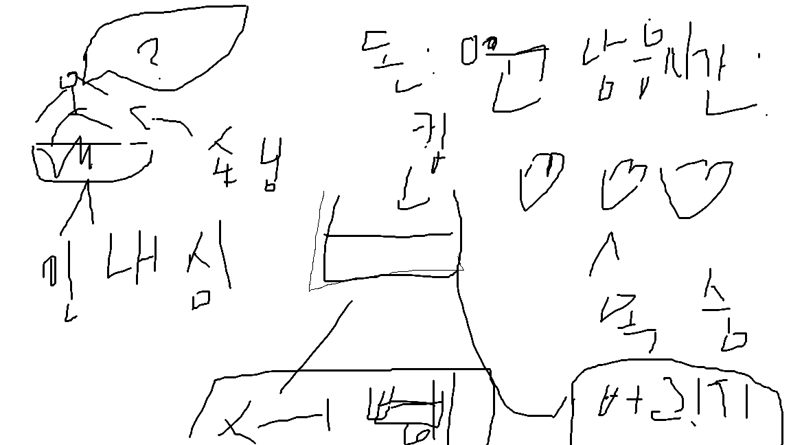
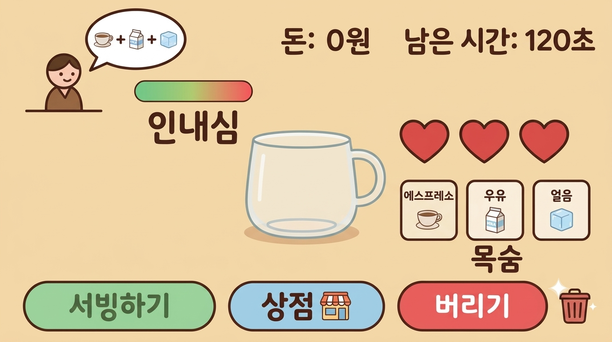

# 📝 게임 기획서

### 3주차 · 보완한 기획서

`WEEK 03` · `기획서 피드백 및 구체화` · `성과물: 보완한 게임 기획서`

2주차 기획서를 Gemini 점검과 튜팅 피드백으로 보완해서 다시 정리합니다. 위쪽 **🤖 Gemini와 기획서 보완하기**를 이용하면 Gemini와 정리한 내용을 이 양식에 바로 채울 수 있어요.

> ✏️ **작성 방법:** 오른쪽 위 연필 ✏️ 아이콘을 누르고 빈칸에 내용을 적은 다음 **Commit changes**를 누르세요.

---

## 1️⃣ 이 게임을 한 문장으로 소개하기

> 예: 고양이가 떨어지는 생선을 받고 폭탄은 피하며 최대한 오래 버티는 게임

**답:** 아기자기한 2D 공간에서 손님 주문에 맞춰 음료를 만들고, 서빙과 상점 해금으로 재미를 더한 귀여운 카페 경영 웹게임입니당

## 2️⃣ 타깃 플레이어

> 이 게임을 누가 할지 적습니다. 아직 못 정했으면 빈칸으로 둡니다.

**답:** 나

## 3️⃣ 레퍼런스 게임 (2~3개)

| 🎮 게임 이름 | 🏷️ 장르 | 👀 참고하고 싶은 점 |
|---|---|---|
| 쿠킹 다이어리(Cooking Diary) | 경영 타이쿤 | 제한 시간 안에 목표 금액 달성, 손님이 화나서 나가면 안 되는 규칙 |
| 커피 토크(Coffee Talk) | 시뮬레이션 | 재료를 넣을 때마다 색이 섞이는 낭만적인 시각적 느낌 |
|  |  |  |

## 4️⃣ 핵심 요소

> 이 게임에서 가장 중요한 재미 요소는 무엇인가요?

**답:** 손님의 주문에 따라 음료 만들기

---

## 5️⃣ 스테이지 1 만들어 보기

> 📌 게임 전체가 아니라 **첫 번째 스테이지 하나만** 생각합니다. 스테이지 1을 만들려면 무엇이 필요한지 적어 봅니다.

### 5-1. 스테이지 1에서 일어나는 일

| 구분 | 내 게임에서는 |
|---|---|
| ▶️ **시작할 때** | 시작하기 버튼을 눌러서 게임을 시작한다 |
| 🔄 **플레이 중** | 재료를 조합해 음료를 만들어 서빙하고 돈을 번다 |
| 🏆 **클리어 조건** | 120초가 지나 '영업 종료'가 되었을 때 정산하여 1000원 벌면 별 1개(기본 클리어), 2000원은 별 2개, 3000원은 별 3개 |
| 💥 **실패 조건** | 120초가 끝났는데 1000원(별 1개)을 못 벌었거나, 손님이 화내며 나가서 화면의 '하트(목숨)' 3개가 다 닳았을 때 즉시 게임 오버 |

### 5-2. 스테이지 1에 등장하는 것들

게임 프로그램은 등장하는 것마다 **갖고 있는 정보**와 **하는 행동**으로 이루어집니다. 아래 표가 나중에 내 프로그램의 구조가 됩니다.

| 이름 | 갖고 있는 정보 (예: 위치, 목숨) | 하는 행동 또는 규칙 (예: 이동, 점프) |
|---|---|---|
| 🧍 **플레이어** | 현재 소지금(돈), 제한시간(120초), 하트 3개(목숨) | 재료 버튼을 눌러 음료를 만들고 손님에게 서빙한다. |
| 손님 | 캐릭터 이모지, 원하는 음료 주문, 인내심 게이지 | 화면에 나타나 음료를 주문하고, 시간에 따라 인내심이 줄어든다. |
| 음료 | 담긴 재료 조합, 액체 색상 | 재료를 넣을 때마다 색이 섞이고 양이 채워진다. |
| 상점 | 해금 가능한 레시피 목록, 해금 가격 | 돈을 사용해 새로운 레시피와 전용 재료를 해금한다. |
| 빈 컵 | 담기는 재료 정보 | 재료 버튼을 누르면 재료가 담긴다. |
| 쓰레기통 | 버리기 기능 | 버리기 버튼을 눌렀을 때 작용하여 컵을 비운다. |

> 플레이어 외에 몬스터, 퍼즐, 아이템, 장애물 등 스테이지 1에 꼭 필요한 것만 적습니다. 부족하면 같은 모양으로 줄을 더 추가해도 돼요.

### 5-3. 입력 방식

> 사용할 입력 방식의 `[ ]`를 `[x]`로 바꾸고, 어떤 입력이 어떤 동작이 되는지 적습니다.

- [ ] ⌨️ 키보드
- [x] 🖱️ 마우스

| 입력 | 게임 속 동작 |
|---|---|
| 예: 스페이스 키 | 점프 |
| 재료 버튼 클릭 | 컵에 에스프레소, 우유, 얼음 등 원하는 재료를 넣는다 |
| 서빙하기 버튼 클릭 | 만든 음료를 손님에게 제출하여 돈과 팁을 번다. |
| 버리기 버튼 클릭 | 잘못 만든 음료를 쏟아 버리고 컵을 비운다. |
| 상점 열기 / 구매 버튼 클릭 | 상점 창을 열고, 번 돈으로 새 레시피와 재료를 해금한다. |

### 5-4. 화면 시점

> 탑다운 / 사이드뷰 / 세로 스크롤 / 고정 한 화면 / 쿼터뷰 / 3D 중 하나와 이유를 적습니다.

**답:** 고정 한 화면 / 카페 경영 게임은 손님의 주문, 재료 버튼, 컵, 쓰레기통이 한눈에 다 들어와야 마우스로 빠르게 클릭할 수 있기 때문

---

## 6️⃣ 더 추가한 것

> 위 칸에 맞지 않지만 보완하면서 새로 정한 것(점수·보상, 아이템, 화면 구성, 소리, 나중에 할 것 등)을 적습니다.

| 항목 | 내용 |
|---|---|
| 음료 기본 가격 | 1000원(별 1개) 달성을 위한 음료 1잔의 기본 가격 설정 (예: 250원 등) |
| 나중에 할 것 | '상점 열기 및 레시피 해금 초반 제외'는 스테이지 1에서는 미루고, 스테이지 1은 기본 재료 3개로 기초 뼈대 위주로 진행 |

---

## 7️⃣ 스테이지 1 화면 그림

> 그림판이나 종이에 그린 스테이지 1 화면과, 그 그림으로 Gemini에게 받은 목업을 올립니다.

**✏️ 내 손그림**

**🖼️ Gemini 목업**

---

🛠️ 4주차에는 이 기획서로 구성요소를 하나씩 만들어요!

